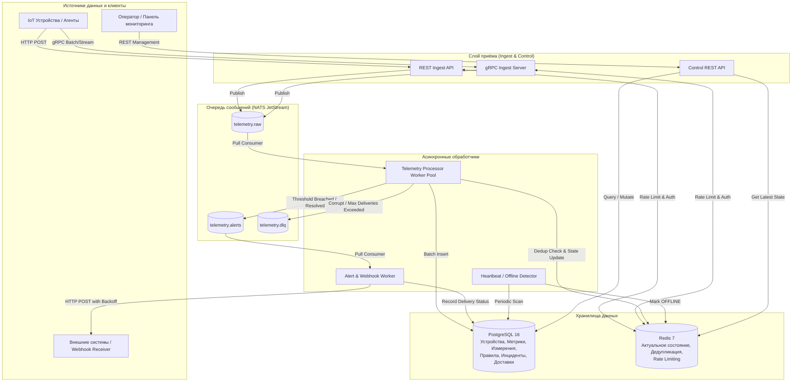
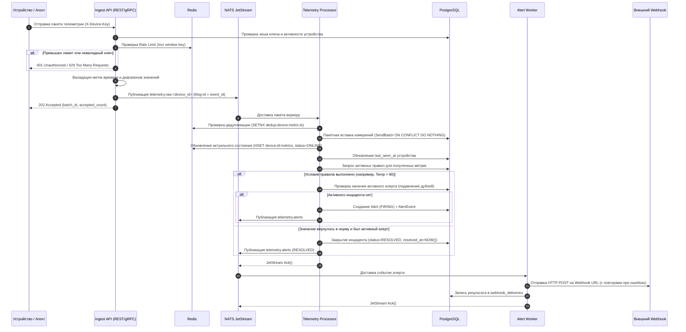
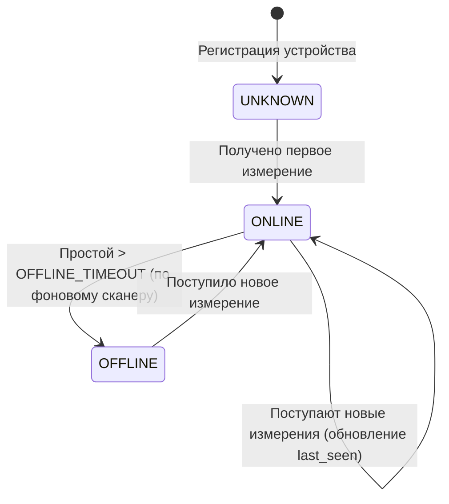
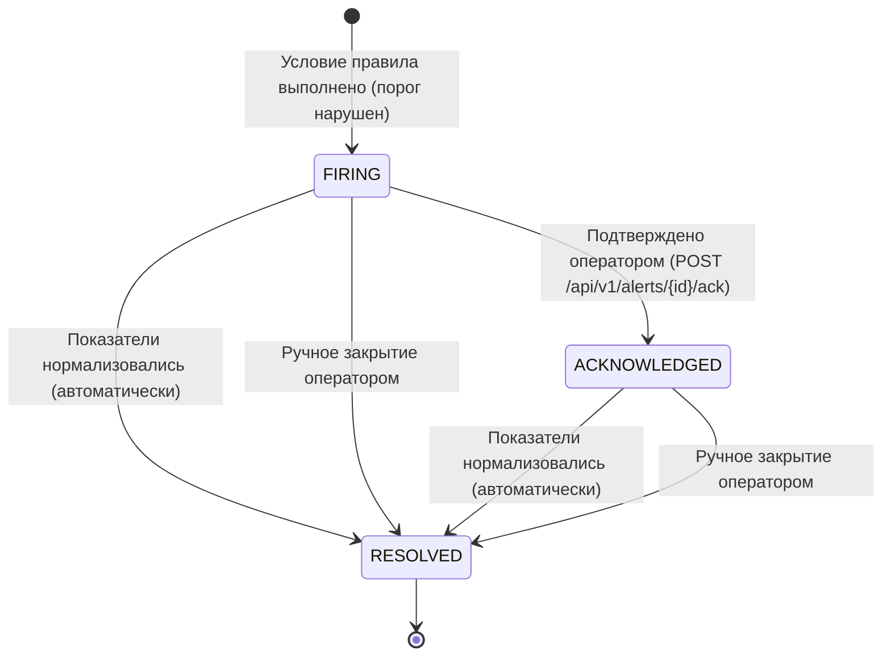
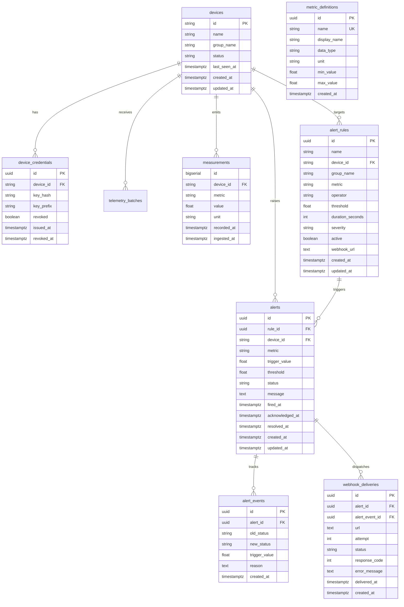

# DevicePulse — Платформа сбора, обработки и мониторинга телеметрии устройств

DevicePulse — высокопроизводительный backend на Go для сбора, конкурентной потоковой обработки, долговременного хранения и анализа телеметрии от IoT-устройств, программных агентов и физических микроконтроллеров.

Система спроектирована по принципам чистой архитектуры (Clean / Hexagonal Architecture) с разделением на независимые слои, нулевой связностью бизнес-логики с деталями инфраструктуры, поддержкой REST и gRPC протоколов, асинхронным контуром на NATS JetStream, кэшированием актуального состояния в Redis и сохранением исторических временных рядов в PostgreSQL.

---

## 1. Архитектура системы

Платформа представляет собой модульный сервис, компоненты которого могут работать совместно в одном процессе (`all-in-one`) либо масштабироваться независимо в виде отдельных микросервисов:

- **Ingest API**: Приём телеметрии через HTTP REST (`POST /api/v1/telemetry`, `POST /api/v1/telemetry/batch`) и gRPC (`TelemetryService.SendBatch`, `TelemetryService.SendStream`). Выполняет аутентификацию по криптографическим ключам, валидацию временных меток/границ значений, ограничение частоты запросов (rate limiting) и публикует принятые пакеты в NATS JetStream.
- **Control API**: REST API для администрирования: регистрация устройств, выпуск и отзыв API-ключей, управление описаниями метрик, настройка правил оповещений, подтверждение и закрытие инцидентов, запрос агрегированной статистики и временных рядов.
- **Telemetry Processor**: Асинхронный воркер-пул потребителей NATS JetStream. Выполняет проверку идемпотентности, пакетную вставку измерений в PostgreSQL, обновление актуального состояния устройств в Redis, вычисление статуса доступности (`ONLINE`, `OFFLINE`, `UNKNOWN`) и оценку пороговых правил алертинга.
- **Alert Worker**: Потребитель событий инцидентов из JetStream. Обеспечивает надёжную доставку webhook-уведомлений с повторными попытками (exponential backoff) и сохранением статусов доставки в БД.

### Архитектурная диаграмма компонентов



---

## 2. Диаграмма последовательности приёма и обработки телеметрии



---

## 3. Модели состояний (State Machines)

### Жизненный цикл доступности устройства



### Жизненный цикл предупреждения (Alert)



---

## 4. Модель данных (ER-диаграмма)



---

## 5. Обоснование технических решений (Rationale)

### 1. Архитектурный стиль: Чистая архитектура и модульный монолит
- **Почему так:** Бизнес-логика (`internal/domain` и `internal/service`) полностью отвязана от внешних библиотек и базы данных через интерфейсы репозиториев (`DeviceRepository`, `TelemetryRepository`, `StateRepository` и т.д.).
- **Преимущество:** Это позволяет запускать всю платформу в режиме `all-in-one` (удобно для разработки, сквозных тестов и небольших инсталляций) либо собирать независимые бинарники из `cmd/` (`ingest-api`, `control-api`, `telemetry-processor`, `alert-worker`) для горизонтального масштабирования под высокой нагрузкой.

### 2. NATS JetStream как событийная шина
- **Почему не обычный RabbitMQ или Kafka:** NATS написан на Go, потребляет минимальное количество памяти, обладает ультранизкой задержкой (sub-millisecond latency) и встроенной поддержкой персистентности (JetStream).
- **Гарантии доставки:** Использована семантика *At-Least-Once* с подтверждением (`Ack()`), отложенным повтором (`NakWithDelay`) при временных сбоях БД, и защитой от неисправимых сообщений (poison pills) через ограничение числа доставок (`MaxDeliver: 5`) и маршрутизацию в `telemetry.dlq`.

### 3. PostgreSQL: pgx/v5, pgxpool и чистый SQL
- **Почему не ORM (GORM/Ent):** ORM создают накладные расходы при высокой частоте вставок, скрывают нюансы работы транзакций и усложняют пакетные операции.
- **Оптимизация:** Применён `pgx.Batch` (`SendBatch`) для групповой вставки сотен измерений за один сетевой round-trip к БД с конструкцией `ON CONFLICT (device_id, metric, recorded_at) DO NOTHING`.
- **Индексы и агрегаты:** Спроектированы B-Tree индексы на `(device_id, metric, recorded_at DESC)`. Расчёт минутных и пятиминутных окон производится через встроенную функцию `date_bin()`, что на порядки быстрее выборки сырых данных в приложение.

### 4. Redis: In-Memory состояние, Rate Limiting и Дедупликация
- **Разделение ответственности:** История и транзакционные данные живут в PostgreSQL. Redis используется только как быстрый буфер оперативного состояния:
  - `HSET device:<id>:metrics` — мгновенное чтение последних значений датчиков без обращения к тяжелой таблице измерений.
  - `SETNX dedup:<device>:<metric>:<ts>` с TTL 24 часа — мгновенная фильтрация дублирующих измерений до записи в диск.
  - Атомарный инкремент с окном для Rate Limiting устройств.
- **Отказоустойчивость:** При потере Redis платформа продолжает принимать и сохранять данные; актуальное состояние может быть восстановлено из последних записей PostgreSQL.

### 5. HTTP-роутер на стандартной библиотеке Go 1.22+
- Начиная с Go 1.22 `net/http.ServeMux` поддерживает сопоставление HTTP-методов и параметров пути (`POST /api/v1/devices/{id}`). Это устранило потребность во внешних тяжелых фреймворках, гарантирует максимальную производительность, нулевую зависимость от сторонних HTTP-библиотек и стандартную совместимость.

### 6. gRPC и Protocol Buffers
- Компактный бинарный формат Protobuf минимизирует накладные расходы на сериализацию и сетевой трафик, что критично для миллионов измерений от сотен устройств. Предоставлены контракты пакетной отправки (`SendBatch`) и клиентского стриминга (`SendStream`).

---

## 6. Запуск и развертывание

### Требования
- Go 1.22+
- Docker и Docker Compose

### 1. Быстрый запуск полного контура через Docker Compose

```bash
docker compose up --build -d
```

Команда запустит:
- PostgreSQL 16 (порт `5432`)
- Redis 7 (порт `6379`)
- NATS JetStream (порты `4222`, `8222`)
- Контейнер `devicepulse-app` (`all-in-one` сервис: REST `8080`, gRPC `50051`)

Миграции базы данных применяются автоматически при старте приложения.

### 2. Локальный запуск без контейнеризации приложения

Если Postgres, Redis и NATS уже запущены:

```bash
# Запуск единого процесса (All-in-One)
go run main.go
```

Или запуск отдельных микросервисов:

```bash
go run ./cmd/control-api
go run ./cmd/ingest-api
go run ./cmd/telemetry-processor
go run ./cmd/alert-worker
```

---

## 7. Генератор нагрузки и стресс-тестирование

В проект включён профессиональный генератор синтетической телеметрии `cmd/load-generator`.

### Возможности:
- Автоматическая предварительная регистрация тестовых устройств и выпуск API-ключей.
- Конкурентная генерация трафика через настраиваемое число воркеров.
- Поддержка обоих протоколов: HTTP REST и gRPC.
- Настраиваемый размер батча и ограничение RPS.
- Расчёт пропускной способности (запросов/сек и измерений/сек).
- Измерение распределения задержки: Min, Avg, p50 (медиана), p95, p99, Max.

### Примеры запуска:

```bash
# Нагрузочное тестирование REST API (50 параллельных устройств, батчи по 20 измерений, длительность 30 секунд)
go run ./cmd/load-generator -transport=rest -workers=50 -batch-size=20 -duration=30s -target=http://localhost:8080

# Высоконагруженное тестирование через gRPC
go run ./cmd/load-generator -transport=grpc -workers=50 -batch-size=50 -duration=30s -target=localhost:50051
```

### Мониторинг и профилирование:
- **Метрики Prometheus**: `GET http://localhost:8080/metrics`
- **Профилирование pprof**:
  - `GET http://localhost:8080/debug/pprof/`
  - `go tool pprof http://localhost:8080/debug/pprof/profile?seconds=30`
  - `go tool pprof http://localhost:8080/debug/pprof/heap`

---

## 8. Запуск unit- и интеграционных тестов

```bash
# Запуск всех тестов
go test -v ./...

# Запуск с проверкой гонок (race detector)
go test -race ./...
```

---

## 9. Документация API

- OpenAPI 3.0 спецификация находится в [`api/openapi/openapi.yaml`](api/openapi/openapi.yaml).
- Protobuf контракты находятся в [`api/proto/telemetry.proto`](api/proto/telemetry.proto).
